<div align="center">
  
</div>

<div align="center">
  <a href="https://git.io/typing-svg">
    
  </a>
</div>

<p align="center">
  
  
  
  
  
  
  <a href="https://github.com/pranta2003/VoltOps-Backend/actions/workflows/ci.yml">
    
  </a>
  <a href="https://github.com/pranta2003/VoltOps-Frontend">
    
  </a>
</p>

---

## 1. Overview & Links

**VoltOps Backend** is the core REST and WebSocket API powering the VoltOps Commercial Field Service Platform. It orchestrates real-time triage, deterministic technician matching across 7 commercial trades, SLA tracking, and multi-role operations for Admin, Dispatcher, Technician, and Customer portals.

- **Frontend Repository:** [https://github.com/pranta2003/VoltOps-Frontend](https://github.com/pranta2003/VoltOps-Frontend)
- **Live Application:** [https://voltops-frontend.vercel.app](https://voltops-frontend.vercel.app)
- **SDP-4 Project Plan:** [`PROJECT_PLAN.md`](PROJECT_PLAN.md)
- **Implementation Progress Ledger:** [`docs/IMPLEMENTATION_PROGRESS.md`](docs/IMPLEMENTATION_PROGRESS.md)

---

## 2. Quick Local Setup

```bash
# 1. Clone repository & install dependencies
git clone https://github.com/pranta2003/VoltOps-Backend.git
cd VoltOps-Backend
npm ci

# 2. Configure environment variables (Windows PowerShell: Copy-Item; Linux/macOS: cp)
Copy-Item .env.example .env

# 3. Validate schema, generate Prisma Client, migrate & seed demo accounts
npx prisma validate
npm run prisma:generate
npm run prisma:migrate
npm run seed

# 4. Start local development server with hot-reload (http://localhost:5000/api)
npm run dev
```

### Seeded Demonstration Credentials
All demo accounts use the standard password: `password123`

| Role | Email | Password | Access Scope |
|---|---|---|---|
| **Admin** | `admin@voltops.test` | `password123` | Enterprise user management, credential audit, system logs |
| **Dispatcher** | `dispatcher@voltops.test` | `password123` | SLA board, technician matching engine, work order Kanban |
| **Technician** | `technician@voltops.test` | `password123` | Mobile job queue, status stepper, skill passport |
| **Customer** | `customer@voltops.test` | `password123` | Breakdown requests, SLA arrival tracking, invoices |

---

## 3. Team Branches & Contribution Flow

| Teammate | Working Branch | Primary Module Ownership |
|---|---|---|
| **Pranta** | `pranta` | Project Lead, system integration, architectural review, PR approvals |
| **Bani** | `bani` | Dispatcher dashboard, service requests, work orders, technician matching |
| **Meshba** | `meshba` | Registration & admin foundation, staff/technician/customer management |
| **Prity** | `prity` | Customer requests, arrival tracking, technician daily jobs, invoices |

```
your-branch ──> Pull Request ──> CI Pass ──> pranta ──> Release PR ──> main
```

---

## 4. PR & Team Git Rules (বাংলা — আবশ্যকীয় নির্দেশিকা)

### 4.1 Daily Sync & Push (প্রতিদিনের ৪টি কমান্ড)
প্রতিদিন কাজ শুরু করার আগে এবং কাজ শেষে push করার নিরাপদ ক্রম:

```bash
# ১. রিমোটের সর্বশেষ তথ্য আনো
git fetch origin

# ২. নিজের নির্ধারিত branch-এ যাও (উদাহরণ: bani)
git switch bani

# ৩. নিজের রিমোট branch-এর আপডেট নিরাপদে নামাও
git pull --ff-only origin bani

# ৪. কোড লেখার পর schema validate ও build পরীক্ষা করো, তারপর push করো
npx prisma validate && npm run build
git push origin bani
```

### 4.2 Pull Request Steps (PR করার নিয়মাবলী)
1. **Push:** নিজের branch-এ সব intended changes commit ও push করো।
2. **Open PR:** GitHub-এ যাও → New Pull Request → **`base: pranta`** ← **`compare: your-branch`** নির্বাচন করো (`main`-এ নয়)।
3. **Check Diff:** PR-এর Files Changed ট্যাবে যাচাই করো কোনো `.env`, secrets বা অন্যের ফাইল ভুল করে ঢুকেছে কি না।
4. **CI & Approval:** GitHub Actions CI (`build`, `prisma validate`) পাস হওয়া এবং টিম লিডের approval ছাড়া merge করবে না।
5. **Branch Retention:** PR merge হওয়ার পরও নিজের personal branch (`pranta`, `bani`, `meshba`, `prity`) কখনোই delete করবে না।

### 4.3 Mandatory Team Git Rules (কঠোরভাবে পালনীয়)
- **`main`-এ সরাসরি push সম্পূর্ণ নিষিদ্ধ;** সকল কোড PR ও CI পাসের মাধ্যমে `pranta` হয়ে `main`-এ যাবে।
- শুধুমাত্র নিজের নির্ধারিত branch-এ কাজ ও push করবে; অন্যের branch-এ অনুমতি ছাড়া push করবে না।
- **Force push (`git push --force`) কখনোই চালাবে না।**
- টিম লিডের অনুমতি ছাড়া `git reset --hard` বা `git clean -fd` চালিয়ে কাজ মুছবে না।
- Merge conflict হলে কাজ থামিয়ে সাহায্য নাও; আন্দাজে file overwrite করবে না।
- `.env`, database URL, API keys বা JWT secrets কখনোই commit বা push করবে না।
- PR করার পূর্বে স্থানীয়ভাবে `npx prisma validate` এবং `npm run build` সফলভাবে সম্পন্ন হতে হবে।
- কাজ শেষ হলেও `pranta`, `bani`, `meshba`, `prity` পার্সোনাল ব্রাঞ্চগুলো স্থায়ীভাবে সংরক্ষিত থাকবে।

---

<div align="center">
  
</div>
